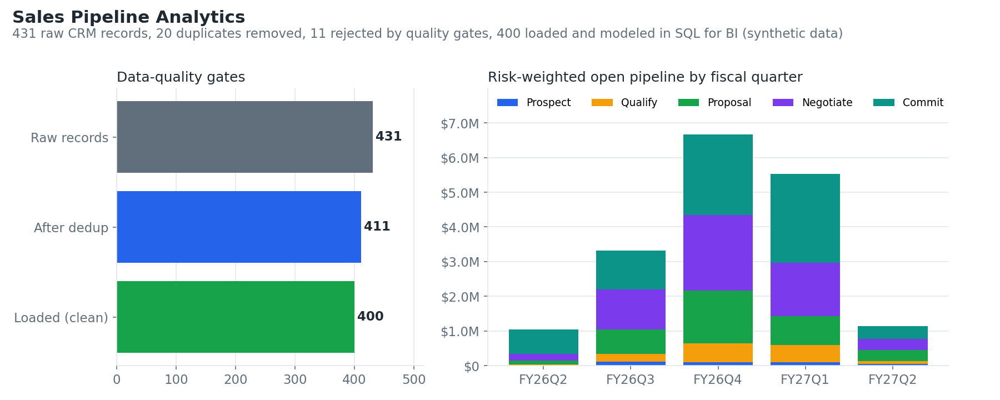

# Alex López – Data Analytics Portfolio

**Senior Data Analyst** | SQL · Python · ETL/ELT · BI · AI/LLM applications

Runnable, tested projects that mirror the work I do in production: turning raw API and CRM data into reliable models, forecasts, audits, and AI-assisted tools. Every project ships with source code, setup notes, and automated tests or checks. The data is **synthetic**, except for the RAG chatbot, which indexes course material that is not redistributed here.

[LinkedIn](https://www.linkedin.com/in/ai-analyst/) · [GitHub profile](https://github.com/MoisesLopez01)



## Start here (2-minute tour)

1. **[sales-pipeline-analytics](projects/sales-pipeline-analytics)** – the end-to-end data engineering flow: API extract, data-quality gates, idempotent warehouse load, SQL models.
2. **[rag-course-qa-chatbot](projects/rag-course-qa-chatbot)** – a grounded LLM chatbot built with LangChain, Chroma and RAG.
3. **[tcc-financial-forecasting](projects/tcc-financial-forecasting)** – compensation cost forecasting in plain SQL.

## Projects

| Project | Business question | Stack | Proof |
| --- | --- | --- | --- |
| [**sales-pipeline-analytics**](projects/sales-pipeline-analytics) | Can raw CRM deal data be loaded reliably and modeled for BI? | Python, SQL, SQLite | Paginated extract, dedup, quality gates, idempotent MERGE, window-function models. **12 tests** |
| [**rag-course-qa-chatbot**](projects/rag-course-qa-chatbot) | Can a chatbot answer only from course content and refuse what it doesn't know? | Python, LangChain, Chroma, Hugging Face, LLM API | 25 lectures, 136 indexed chunks, cited answers, out-of-scope question declined |
| [**tcc-financial-forecasting**](projects/tcc-financial-forecasting) | What will total cash compensation cost after attrition? | SQL, SQLite | Attrition proration, cost drivers, actuals vs. forecast. **4 tests** |
| [**global-comp-reporting**](projects/global-comp-reporting) | How do salaries compare across currencies and cost of living? | Python, Vertex AI | Currency normalization, COL adjustment, micro-banding, market benchmarking with offline fallback. **6 tests** |
| [**goals-quality-audit**](projects/goals-quality-audit) | Which performance goals break policy before bonus review? | Python, pandas | Rule engine with exception reporting. **5 tests** |
| [**ai-sales-analytics**](projects/ai-sales-analytics) | Which customers are likely cross-sell targets? | Python, scikit-learn | KMeans + PCA recommender on won-deal data. **4 tests** |

## Skills shown

- **SQL and modeling:** CTEs, joins, window functions, idempotent upserts, layered raw → staging → model design
- **Python:** pandas, NumPy, scikit-learn, pytest
- **Pipelines and quality:** REST API extraction, pagination, deduplication, data-quality gates, run-audit tables
- **Analytics:** forecasting, compensation analytics, compliance auditing, segmentation
- **AI/LLM:** LangChain (LCEL), retrieval-augmented generation, vector databases, prompt design, Vertex AI

## Run any project

```bash
# Example: the flagship ETL pipeline
cd projects/sales-pipeline-analytics
pip install -r requirements.txt
python src/generate_sample_data.py --out data/sample_deals.json --n 400
python src/pipeline.py --source data/sample_deals.json --db warehouse.db --verbose
python -m pytest tests/ -q          # 12 passed
```

Each project's own README covers the problem, approach, results, and run steps.

## License

MIT © 2026 Moises Alexander López (Alex López)
