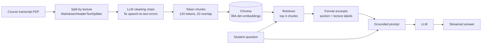

# RAG Q&A Chatbot for Course Content

A retrieval-augmented generation (RAG) tutor built with **LangChain**, **Chroma**, and an **LLM API**. It answers student questions about a 25-lecture video course using only the course transcript, names the lecture it drew from, and declines questions the course does not cover.


## Example answers

Real output from the notebook (Part 9):

> **Student:** What is the difference between a dimension and a measure?
> **Tutor:** Dimensions are categorical, qualitative fields that cannot be aggregated, while Measures are numerical, quantitative fields that can be aggregated. (See Section: Introduction to Tableau – Lecture: Exploring Tableau's interface, Excerpt 2)

> **Student:** How do I configure a Hadoop cluster for Tableau?
> **Tutor:** This course does not cover configuring a Hadoop cluster for Tableau.

The second answer is the point of the project: the tutor stays grounded in the source material instead of inventing an answer.

## How it works



| Step | What it does | Key tools |
| --- | --- | --- |
| 1. Load | Reads the 49-page transcript | `PyPDFLoader` |
| 2. Split by structure | 25 lectures, each tagged with section and title | `MarkdownHeaderTextSplitter` |
| 3. Clean | LLM rewrites speech-to-text errors; no new facts; cached to disk | LCEL, `RunnableLambda`, `StrOutputParser` |
| 4. Chunk | 136 token chunks, metadata copied to each | `TokenTextSplitter` |
| 5. Index | Local embeddings, persisted vector store | `HuggingFaceEmbeddings`, Chroma |
| 6. Prompt | Answer only from excerpts; say when a topic is not covered | `ChatPromptTemplate` |
| 7–8. Chain | Parallel retrieval + passthrough, formatted context | `RunnableParallel`, `RunnablePassthrough` |
| 9. Stream | Token-by-token output | `.stream()` |

## Results

- **25 / 25** lectures split with correct section and title metadata
- **136** chunks indexed; regression check confirms index count equals chunk count
- Retrieval test: the join vs. blending question returns the *Blending Data in Tableau* lecture as all top 4 hits
- **4 / 4** demo questions answered, including the out-of-scope question correctly declined
- Local tests (`assert` cells) cover loading, splitting, chunking, embeddings, prompt rendering and context formatting without calling the API

## Design choices

- **Clean before you embed.** Speech-to-text noise (`dash board`, `dimenshuns`) hurts both retrieval and answers. A deterministic LLM pass (temperature 0, fixed seed) fixes it once and caches the result.
- **Metadata travels with every chunk.** Splitting by headers first means each chunk knows its section and lecture, so answers can cite their source.
- **Local embeddings.** `all-MiniLM-L6-v2` runs on the machine, costs nothing per query, and keeps the index reproducible.
- **Grounding over fluency.** The system prompt forbids invented menu paths or formulas and requires a "not covered" reply when the excerpts do not support an answer.
- **Model is swappable.** The chain uses `ChatGroq` with OpenAI's open-weight `gpt-oss-120b`; switching to `ChatOpenAI` and `OpenAIEmbeddings` changes two lines.

## Run it

```bash
git clone https://github.com/MoisesLopez01/Portfolio.git
cd Portfolio/projects/rag-course-qa-chatbot
python -m venv .venv && source .venv/bin/activate   # Windows: .venv\Scripts\activate
pip install -r requirements.txt
cp .env.example .env                                # then add your GROQ_API_KEY
```

Add a course transcript PDF to `data/` (see [data/README.md](data/README.md)), then open `rag_course_qa_chatbot.ipynb` and run all cells.

## Project structure

```text
rag-course-qa-chatbot/
├── rag_course_qa_chatbot.ipynb   # full pipeline, parts 1–9 + regression checks
├── requirements.txt
├── .env.example                  # GROQ_API_KEY placeholder
├── data/
│   └── README.md                 # where the transcript goes (not committed)
├── LICENSE
└── README.md
```

## Credential

Capstone project for **Build Chat Applications with OpenAI and LangChain**, 365 Data Science (November 2026, credential ID CC-4600EC8466).

## Author

**Alex López** – Senior Data Analyst | SQL, Python, BI and AI automation
[LinkedIn](https://www.linkedin.com/in/ai-analyst/) · [Portfolio](../../README.md)

## License

[MIT](./LICENSE) © 2026 Moises Alexander López (Alex López)
