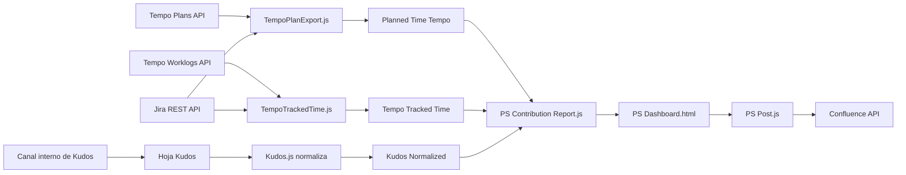

# Evidencia técnica para el Proyecto Final W20 a V3

**Fecha de revisión:** 29 de septiembre de 2026  
**Estado:** referencia interna para la Memoria y el informe al director  
**Alcance:** comparación de la copia identificada por el autor como 2026.W20 con la versión V3 actualmente en uso

## Conclusión

La versión V3 conserva el alcance aprobado en el D0 y el D1. Es una intervención incremental sobre un dashboard existente, no una aplicación creada desde cero durante el Proyecto Final. Las mejoras comprobables se concentran en la trazabilidad de fuentes, la organización de la interfaz, el registro histórico individual, la administración por roles, la analítica de uso y la publicación directa del resumen ejecutivo en Confluence.

La copia W20 ya incluía identidad visual de ServiceRocket, modo oscuro, filtros, Overview, Team Radar, Top Rocketeers, Trends, Data Reference, Settings, un Team Executive Brief y una función manual para copiar contenido con formato hacia Confluence. Por ello, la Memoria debe describir V3 como una ampliación, reorganización y automatización de esas capacidades.

## Versiones examinadas

### Línea base W20

Ruta declarada por el autor:

`C:\Users\moise\Downloads\PS back in June week20.2026\servicerocket-ops-wfp-reports-b57d73429eab\PSContributionReport`

La carpeta no contiene un directorio `.git`. Su fecha histórica no puede demostrarse mediante un commit. Para la Memoria debe identificarse como una copia proporcionada por el autor y rotulada como W20. Las huellas SHA-256 permiten comprobar que los archivos no cambien a partir de esta revisión.

| Archivo | SHA-256 |
|---|---|
| `PS_Dashboard.html` | `EDDE87A78D2FCA41566F9ACE49FF19C5C66D248E6E0CED3E27CE2FB45C6C3641` |
| `PS_Contribution_Report.js` | `D80CF2436488B758115280EC6DE80EF7FD5E1A6147057F9FAC42FDAA0A7E7C29` |
| `PS_Security.js` | `0798F0F51C00E2D9571714B0421CDF297CAA1779F9CD07075C211F3BCAFDC34D` |
| `appsscript.json` | `124E3C47A935BF61FAE14A52F52817E4D28C5C8C54F158B3C72DA6281A719E62` |

### Versión V3 en uso

Ruta examinada:

`D:\Development\ps-dashboard`

El directorio pertenece a un repositorio más amplio y contiene cambios sin consolidar. El último commit disponible no representa por sí solo todos los archivos examinados. Para esta revisión, las huellas siguientes identifican el estado exacto de los cinco componentes principales:

| Archivo | SHA-256 |
|---|---|
| `PS Contribution Report.js` | `92C68E72A08C2CA077A9503F720D54ED113543F34F5C651B42FB44F2432F1536` |
| `PS Dashboard.html` | `7E565D456C96440D295F77D1187C21D6B01F8D50946266FE0CC36DCEE579FD65` |
| `PS Security.js` | `6CA6FC2E945465BD945072D8ED517FBECB626D8886F1C3E671E5D387DF5DE3D6` |
| `PS_Post.js` | `FD241DE1D008DDF304D6F189B48B5CEBD9E6CDF6559E513EA3406B2CF2B3E701` |
| `PS Teams.js` | `1301ACBCEA710D3E29021521EBF26A2C016A2920EB6C7472A8B7A457E1F16501` |

Estas huellas no contienen datos personales ni secretos. No deben añadirse a la Memoria completa salvo que se necesite demostrar la identificación de la versión; son más apropiadas para un anexo técnico o registro de trabajo.

## Diferencias verificables entre W20 y V3

| Componente | W20 | V3 | Formulación segura para la Memoria |
|---|---|---|---|
| Identidad visual | Ya tenía logotipo, paleta corporativa, Roboto, Roboto Condensed y modo oscuro | Añade una navegación lateral, mejor jerarquía y separación de vistas | Rediseño y estandarización de la experiencia, no primera incorporación de marca |
| Navegación | Pestañas superiores: Overview, Team Radar, Top Rocketeers, Trends, Data Reference y Settings | Secciones diferenciadas para Leading Behaviours, Team Executive Brief, Performance Record, Documentation, Scoring Weights, Access Control y Usage Analytics | Reorganización de la arquitectura de información y mayor visibilidad de funciones |
| Confluence | Copia HTML enriquecido al portapapeles para pegarlo manualmente | Publica o actualiza la sección correspondiente mediante la API de Confluence, con confirmación y control de acceso administrativo | Automatización de la publicación; el formato para Confluence ya existía |
| Tendencias | Incluía Trends y hasta 24 semanas de historia de tiempo registrado | Performance Record integra varias métricas por persona y permite lectura semanal, mensual y trimestral | Consolidación histórica individual y mult métrica, no primera existencia de tendencias |
| Ventana histórica | Vista principal móvil de cinco semanas y tendencias adicionales | Implementa el trimestre actual y los dos trimestres anteriores para el registro individual | Continuidad de tres trimestres con granularidad seleccionable |
| Ponderaciones | Pesos base configurables dentro de Settings | Matriz por equipo, familia y nivel, con administración separada | Mayor trazabilidad y adecuación de aplicabilidad por cohorte |
| Acceso | Control de acceso y alcance por manager | Modelo ampliado de roles, alcance organizativo, vista delegada y filtrado en servidor | Fortalecimiento del control y la minimización de datos |
| Analítica de uso | No se encontró una vista de uso | Registra visitas y limita la analítica a superadministradores | Función nueva y complementaria; no demuestra por sí sola utilidad o adopción |
| Narrativa | Team Executive Brief y apoyo opcional de Gemini | Brief independiente, publicación directa y mayor detalle de evidencia | Evolución operativa de la narrativa; la IA continúa siendo asistencia sujeta a revisión humana |

## Arquitectura y dependencia de fuentes

El dashboard no consulta todas las plataformas externas durante cada carga de página. Los procesos de extracción preparan hojas intermedias en Google Sheets y `PS Contribution Report.js` las lee para ensamblar el resultado. Esta diferencia entre sistema de origen y fuente inmediata debe conservarse en la matriz de fuentes del PF.

### Jira

Jira tiene dos papeles diferentes que no deben mezclarse:

1. Los procesos de Tempo utilizan Jira para resolver nombres visibles, proyectos, claves de incidencia, responsables de proyecto y trazabilidad de los ítems asociados a planes o worklogs.
2. El repositorio contiene un proceso independiente de seguimiento de backlog y actividad de Jira. Su salida puede apoyar análisis complementarios, pero el dashboard V3 ensambla sus métricas principales desde las hojas configuradas; no ejecuta una consulta general a Jira en cada visita del usuario.

La dependencia de Jira en Planned y Tracked Time es principalmente de enriquecimiento y trazabilidad. Si Tempo responde y Jira no permite resolver un ítem, pueden conservarse horas con contexto incompleto. Esta condición debe registrarse como incidencia de calidad, no convertirse silenciosamente en cero horas.

### Tempo Planned Time

`TempoPlanExport.js` consulta las asignaciones planificadas, descubre miembros mediante Tempo Teams, resuelve nombres y contexto de proyecto con Jira, agrupa por persona, proyecto y semana ISO, y escribe la hoja intermedia `Planned Time Tempo`. El dashboard lee esa hoja y aplica reglas adicionales, incluida la capacidad semanal después de PTO y la exclusión de claves que no representan proyectos.

El código contiene una función para instalar una actualización semanal los lunes a las 08:00. La documentación visible del dashboard declara una exportación diaria para Planned Time. Esta diferencia debe corregirse o justificarse mediante evidencia del trigger realmente instalado en producción.

### Tempo Tracked Time

`TempoTrackedTime.js` obtiene worklogs de Tempo, atribuye las horas al autor real, elimina duplicados mediante una huella de contenido, resuelve incidencias y proyectos con Jira, agrupa por semana ISO y escribe `Tempo Tracked Time`. También deja una marca de última exportación que el dashboard recupera para mostrar vigencia.

El código contiene una función para instalar una actualización diaria a las 06:00. El estado del trigger instalado debe comprobarse en Apps Script durante los cuatro cortes semanales; la presencia de la función en el código no demuestra que el trigger esté activo.

### Kudos

`Kudos.js` lee la hoja bruta `Kudos`, divide registros con varios destinatarios y produce `Kudos_Normalized`, con una fila por receptor. `PS Contribution Report.js` calcula tanto reconocimientos recibidos como entregados, por semana y por persona.

No se encontró en `Kudos.js` un trigger programado para ejecutar `runKudosNormalizer()`. Debe documentarse cómo se actualiza realmente en producción y quién controla su periodicidad. Además, la pestaña Documentation de V3 contiene dos inconsistencias que deben corregirse antes de usarla como evidencia del PF:

- identifica `Kudos given` como procedente de un export de NetSuite, aunque el código consume `Kudos_Normalized`;
- muestra el nombre `Kudos given` junto a una definición que describe reconocimientos recibidos.

La solución recomendable es distinguir explícitamente `Kudos given` y `Kudos received`, o utilizar `Recognition activity` cuando la vista combine ambas direcciones.

### Confluence

`PS_Post.js` implementa una integración directa con la API de Confluence. La publicación está restringida a roles administrativos, pide confirmación en la interfaz y crea o actualiza la sección del blog semanal. Las credenciales se almacenan en Script Properties y no deben figurar en la Memoria, capturas, anexos ni repositorios compartidos.

La automatización de Confluence es una extensión operativa compatible con el D0 y el D1. No sustituye los indicadores I1 a I5 ni debe presentarse como evidencia de comprensión de los usuarios.

## Verificación automatizada de V3

El 29 de septiembre de 2026 se ejecutaron nueve archivos de comprobación incluidos en `tests`. Los 603 controles terminaron sin fallos.

| Área | Comprobaciones superadas |
|---|---:|
| Editor de listas de acceso | 48 |
| Niveles y alcance de acceso | 222 |
| Superficie de funciones invocables | 26 |
| Ventanas fiscales | 15 |
| Cierre de acceso ante errores | 35 |
| Performance Record | 138 |
| Team Radar | 26 |
| Adaptación responsive | 36 |
| Usage Analytics | 57 |
| **Total** | **603** |

Estas pruebas respaldan el comportamiento del código revisado. No demuestran por sí solas que:

- los valores coincidan con Jira, Tempo, Kudos u otras fuentes en producción;
- los triggers estén instalados y ejecutándose con la periodicidad declarada;
- el despliegue publicado corresponda exactamente a esta carpeta local;
- los usuarios comprendan mejor la información o la consideren útil.

Las primeras tres condiciones se documentan con la matriz de fuentes, los cuatro cortes semanales, los registros de ejecución y la identificación del despliegue. La comprensión y utilidad se documentan mediante las ocho sesiones previstas en el D1.

## Correspondencia con los objetivos del PF

| Objetivo o indicador | Evidencia aportada por V3 | Evidencia que todavía debe recogerse |
|---|---|---|
| OE1, I1 e I2 | Lectores separados, fechas de exportación, reglas de población y documentación de fuentes | 120 comprobaciones en cuatro cortes, diferencias, tolerancias y correcciones |
| OE2 e I3 | Pesos base y matriz por equipo, familia y nivel; reglas de aplicabilidad | Revisión directiva versionada y estado de cada decisión |
| OE3 | Navegación, Documentation, Team Executive Brief, Performance Record y publicación en Confluence | Capturas mock y comprobación de que cada vista muestra corte, cobertura y limitaciones |
| OE4, I4 e I5 | Prototipo V3 disponible en producción | Ocho sesiones con tareas equivalentes, cuestionario y comentario abierto |
| OE5 | Arquitectura y funciones ya desplegadas | Plan de sostenibilidad, responsables, riesgos y escenario de valor |

## Afirmaciones respaldadas y afirmaciones que deben evitarse

### Respaldadas por el código revisado

- V3 integra un registro de desempeño individual con vista semanal, mensual y trimestral.
- El registro cubre el trimestre vigente y los dos trimestres anteriores.
- Planned Time y Tracked Time proceden de procesos de Tempo enriquecidos con información de Jira.
- Kudos se normaliza antes de su agregación y permite diferenciar quién recibe y quién reconoce.
- La publicación en Confluence pasó de una copia manual a una integración directa y controlada.
- El sistema aplica control de acceso y recorta datos en el servidor según el alcance del usuario.
- V3 incorpora registro de visitas y una vista restringida de analítica de uso.

### Deben evitarse hasta obtener evidencia de campo

- afirmar que V3 mejoró la calidad de las decisiones salariales;
- afirmar ahorro de tiempo, adopción o satisfacción sin medición;
- presentar el índice compuesto como valoración definitiva de desempeño;
- atribuir ingresos individuales mediante RCR;
- decir que todas las fuentes se actualizan diariamente;
- presentar 603 pruebas de código como si fueran 603 validaciones de datos reales;
- afirmar que la versión local y el despliegue productivo son idénticos sin registrar la versión desplegada.

## Evidencia recomendada para la Memoria

1. Una tabla resumida W20 frente a V3, sin incluir código completo.
2. Un diagrama de flujo de las fuentes y hojas intermedias.
3. Capturas de V3 con datos sintéticos y una etiqueta permanente de mock data.
4. Un manifiesto de archivos y huellas SHA-256 en el registro técnico.
5. Extractos breves de las funciones que muestran la lectura de fuentes, la marca de actualización y el control de acceso.
6. Registro de los triggers realmente instalados, sin IDs ni credenciales.
7. Resultados de los cuatro cortes semanales y de las ocho sesiones con usuarios.

No se recomienda incluir el código completo en el cuerpo de la Memoria. El código puede conservarse como evidencia técnica y describirse mediante arquitectura, reglas, pruebas y fragmentos seleccionados.

## Pendientes antes de cerrar el informe al director

1. Confirmar el identificador o número de versión del despliegue V3 sin registrar secretos.
2. Comprobar en Apps Script los triggers activos de Tempo Planned, Tempo Tracked, Jira y Kudos.
3. Corregir en Documentation la fuente, cadencia y definición de Kudos y la cadencia de Planned Time.
4. Crear una copia congelada de los archivos evaluados con este manifiesto de huellas.
5. Generar las capturas mock del Performance Record y del flujo hacia evidencia detallada.
6. Ejecutar los cuatro cortes de fidelidad y vigencia comprometidos en el D1.
7. Mantener la automatización de Confluence fuera del cálculo de I1 a I5; presentarla como resultado operativo adicional.

## Texto breve para el informe al director

La versión V3 fue contrastada con una copia funcional identificada como 2026.W20. La comparación confirma que el Proyecto Final no parte de cero: W20 ya disponía de un dashboard multifuente, identidad visual, tendencias, documentación, controles de acceso y un resumen ejecutivo. V3 amplía esa base mediante una navegación reorganizada, un registro individual que integra tres trimestres con granularidad semanal, mensual y trimestral, una matriz de ponderaciones por cohorte, analítica de uso y publicación directa en Confluence. Los procesos de tiempo planificado y registrado se originan en Tempo y utilizan Jira para resolver personas, proyectos e incidencias antes de escribir hojas intermedias que consume el dashboard. Los reconocimientos se normalizan desde una hoja interna antes de su agregación. Esta revisión técnica respalda la existencia de las funciones, pero la fidelidad, vigencia, comprensión y utilidad continuarán evaluándose con los cuatro cortes y las ocho sesiones establecidos en el D1.

