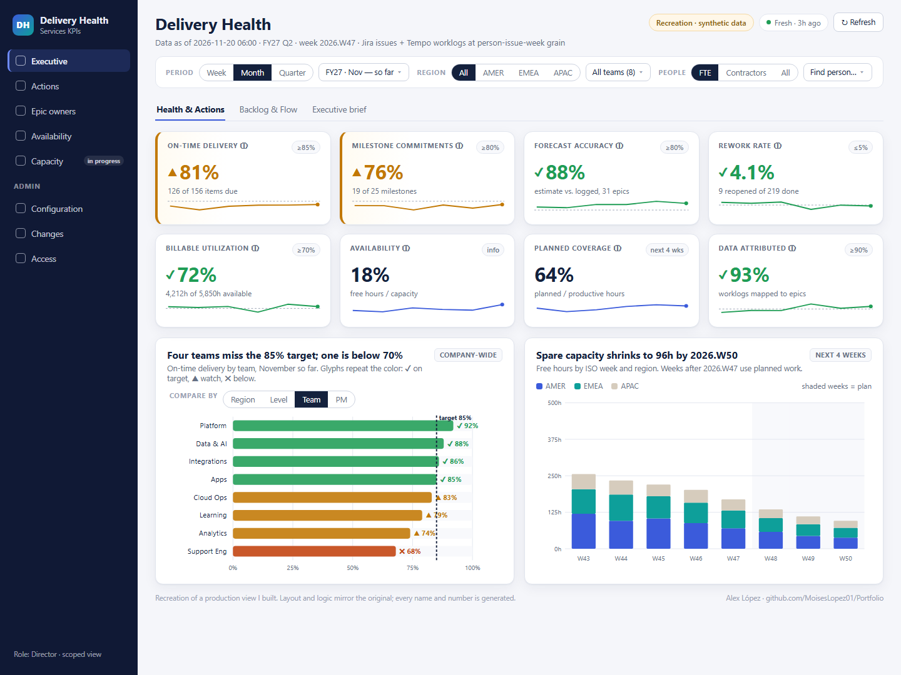
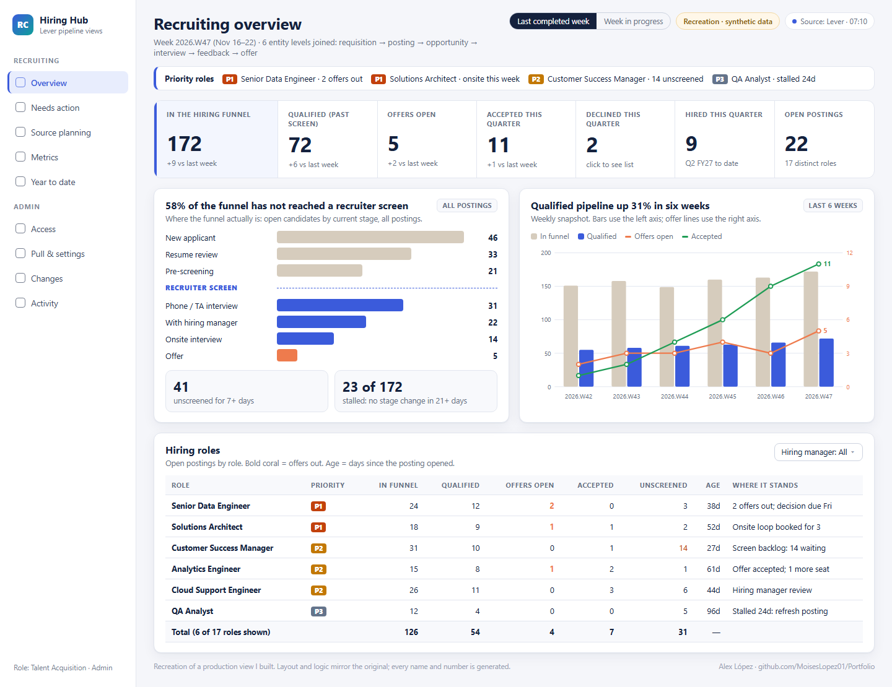
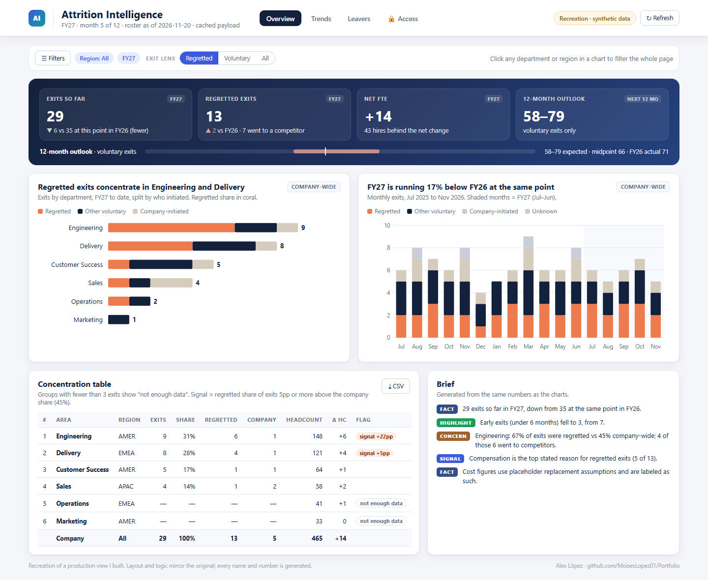
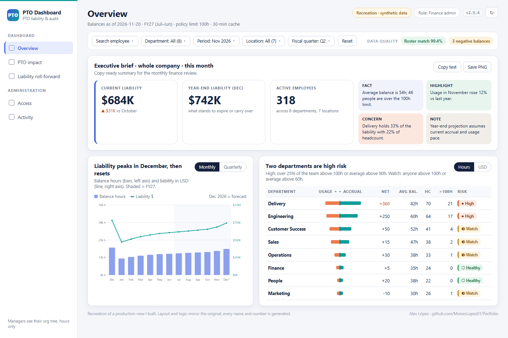

# Custom Dashboard Gallery

I build custom analytics web apps for leadership teams: workforce planning, delivery health, recruiting, and people-cost views. The production versions run on live HR, Jira, Tempo, and Lever data, so they can't be shared.

These four pages are **recreations**. Each one keeps the layout, metrics, business rules, and interaction patterns of a view I built, but **every name and number is synthetic** and the color palette is neutral. Open any `.html` file in `dashboards/` in a browser to see it live; the charts are hand-built SVG with no external libraries.

| View | Audience | What it answers |
| --- | --- | --- |
| [Delivery Health](#delivery-health) | Services leadership | Are teams delivering on time, and is there spare capacity in the coming weeks? |
| [Recruiting overview](#recruiting-overview) | Talent Acquisition, hiring managers | Where is the funnel stuck, and which priority roles need a decision? |
| [Attrition Intelligence](#attrition-intelligence) | CEO, People leadership | Who is leaving, is it regretted, and where is it concentrated? |
| [PTO Liability](#pto-liability) | Finance, People | How much PTO liability do we carry, and which departments are at risk? |

---

## Delivery Health

- Eight KPI tiles (on-time delivery, milestone commitments, forecast accuracy, rework, utilization, availability, coverage, data attribution), each with a target, a 6-period sparkline, and a ✔ / ▲ / ✖ glyph so status never relies on color alone.
- Drill-down compares any metric by Region, Level, Team, or PM against its target.
- Free-capacity chart by ISO week, with planned weeks shaded.
- Production version: Jira issues and Tempo worklogs modeled at person-issue-week grain; margin-related tiles are hidden from roles below manager.

## Recruiting overview

- KPI strip with week-over-week change, and a funnel split at the recruiter screen so a backlog of unscreened candidates is visible.
- Six-week combo chart: pipeline volume on one axis, offers on another.
- Hiring roles table with priority tags, unscreened counts, posting age, and a plain-language "where it stands" column.
- Production version: Lever data joined across six levels (requisition → posting → opportunity → interview → feedback → offer).

## Attrition Intelligence

- Summary band comparing exits to the same point last fiscal year, plus a 12-month outlook range.
- Exits by department and by month, split into regretted, other voluntary, company-initiated, and unknown.
- Concentration table that flags a group only when its regretted share is 5pp or more above the company, and shows "not enough data" for groups with fewer than 3 exits.
- A brief generated from the same numbers as the charts, tagged Fact / Highlight / Concern / Signal.

## PTO Liability

- Executive brief with current and year-end liability, ready to paste into the monthly finance review.
- Balance hours and liability in USD on two axes, showing the December peak and January reset.
- Department risk table with a usage-vs-accrual bar and a rule-based risk tier (High / Watch / Healthy).
- Data-quality chips (roster match, negative balances) sit next to the filters, so problems are visible before anyone reads a number.

---

## Patterns I build into every view

| Pattern | Why it matters |
| --- | --- |
| Freshness stamp on every page | Readers know how current the numbers are |
| Role-based scoping, enforced server-side | Sensitive pay and HR fields never reach unauthorized browsers |
| Titles that state the finding | The chart's point is readable in one line |
| Status glyphs as well as color | Readable for color-blind users and in print |
| Low-sample suppression | Small groups are not over-interpreted or exposed |
| Metric definitions next to the metric | Formula, source, grain, and owner are one click away |
| PNG / CSV export and copy-ready briefs | Numbers move into decks and emails without retyping |
